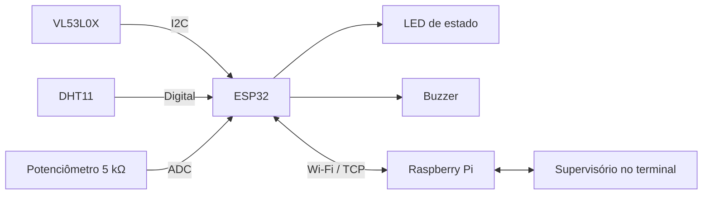

# IndustrialMonitoring
Autores:    Gabriel Dezejácomo Maruschi
            Matheus Cavalcanti de Santana
# Sistema Embarcado de Monitoramento e Supervisão Industrial

**SEL0630 — Projetos em Sistemas Embarcados | Projeto Final — Parte 3**
Professor:  Pedro Oliveira

## 1. Descrição do projeto

O projeto consiste em uma prova de conceito de monitoramento e supervisão de uma máquina industrial. O sistema utiliza um ESP32 para aquisição de dados dos sensores, execução de uma máquina de estados e controle local dos atuadores. Uma Raspberry Pi, executando Linux, recebe os dados via Wi-Fi e disponibiliza uma interface de supervisão no terminal.

A arquitetura distribui as responsabilidades entre as duas plataformas:

- **ESP32:** leitura dos sensores, avaliação das condições operacionais, controle do LED e do buzzer e execução da máquina de estados.
- **Raspberry Pi:** servidor TCP, apresentação da telemetria em um painel fixo no terminal e envio de comandos de controle.

A lógica de controle permanece no microcontrolador, permitindo o funcionamento local mesmo quando a conexão com a Raspberry Pi é perdida. Trata-se de um protótipo didático, não de um sistema de segurança industrial certificado.



## 2. Componentes e montagem

### Hardware necessário

- ESP32 DevKit V1 (ESP32-WROOM-32);
- Raspberry Pi com Linux e acesso à rede Wi-Fi;
- sensor de distância VL53L0X (ToF, infravermelho);
- sensor de temperatura e umidade DHT11;
- potenciômetro de 5 kΩ;
- um LED e um resistor de 220–330 Ω;
- buzzer;
- protoboard, jumpers e cabos de alimentação/USB.

### Mapeamento dos pinos do ESP32

| Componente | Terminal | Conexão no ESP32 |
| --- | --- | --- |
| VL53L0X | SDA | GPIO 21 |
| VL53L0X | SCL | GPIO 22 |
| VL53L0X | VIN/VCC | 3,3 V, se compatível com o módulo |
| VL53L0X | GND | GND |
| DHT11 | DATA | GPIO 4 |
| DHT11 | VCC | 3,3 V, se compatível com o módulo |
| DHT11 | GND | GND |
| Potenciômetro | Extremidade 1 | 3,3 V |
| Potenciômetro | Cursor | GPIO 34 (ADC1) |
| Potenciômetro | Extremidade 2 | GND |
| LED | Ânodo, através do resistor | GPIO 25 |
| LED | Cátodo | GND |
| Buzzer | Sinal de acionamento | GPIO 27 |
| Buzzer | Referência | GND |

O GPIO 34 pertence ao ADC1 e permite a leitura analógica enquanto o Wi-Fi está em operação. Todos os periféricos ligados ao ESP32 devem compartilhar o GND. A Raspberry Pi não necessita de conexão física com os GPIOs do ESP32.

**Cuidados de montagem:**

- Não aplicar 5 V diretamente às entradas do ESP32.
- Se o DHT11 não possuir resistor de pull-up integrado, utilizar um resistor de aproximadamente 10 kΩ entre DATA e 3,3 V.
- O VL53L0X deve ser alimentado conforme a especificação de seu módulo breakout; verificar também a compatibilidade dos níveis I²C.
- O firmware distribuído considera um buzzer ativo de 3,3 V e baixo consumo, com acionamento em nível alto. Para um buzzer passivo, é necessário gerar um sinal periódico (por exemplo, com `tone()`); para modelos de maior corrente ou de outra tensão, utilizar um circuito de acionamento adequado. Não alimentar cargas que excedam a capacidade do GPIO diretamente pelo pino.

## 3. Organização dos arquivos

Na distribuição original do projeto, os arquivos estão organizados da seguinte maneira:

```text
monitoramento_industrial_esp32_rpi/
├── platformio.ini
├── README.md
├── esp32_maquina_industrial/
│   ├── esp32_maquina_industrial.ino
│   ├── Config.h
│   ├── ConfigLimites.h
│   ├── Sensores.h
│   ├── Sensores.cpp
│   ├── Atuadores.h
│   ├── Atuadores.cpp
│   ├── MaquinaEstados.h
│   ├── MaquinaEstados.cpp
│   ├── Comunicacao.h
│   └── Comunicacao.cpp
├── raspberry_pi/
│   └── servidor_tcp.py
└── testes/
```

| Módulo | Responsabilidade |
| --- | --- |
| Arquivo principal (`.ino` ou `main.cpp`) | Inicialização e execução do loop principal |
| `Config.h` | Wi-Fi, endereço da Raspberry Pi, pinos e intervalos de execução |
| `ConfigLimites.h` | Limites de operação, histerese e tempo de inicialização da máquina |
| `Sensores.h/.cpp` | Aquisição, validação e simulação das leituras |
| `Atuadores.h/.cpp` | Controle do LED e do buzzer |
| `MaquinaEstados.h/.cpp` | Estados, transições e validação dos comandos |
| `Comunicacao.h/.cpp` | Conexão Wi-Fi/TCP, reconexão, telemetria e comandos |
| `servidor_tcp.py` | Servidor TCP e interface de supervisão no terminal |

## 4. Configuração do ESP32 no VS Code (PlatformIO)

### 4.1. Instalação do ambiente

1. Instalar o [Visual Studio Code](https://code.visualstudio.com/).
2. Abrir a aba **Extensions** (`Ctrl+Shift+X`).
3. Pesquisar por **PlatformIO IDE** e instalar a extensão.
4. Aguardar a instalação do PlatformIO Core e a inicialização da extensão.

### 4.2. Criação de um novo projeto

1. Abrir o PlatformIO pelo ícone da extensão na barra lateral do VS Code.
2. Acessar **PIO Home > Open > New Project**.
3. Preencher os campos conforme a tabela:

   | Campo | Valor |
   | --- | --- |
   | Name | `monitoramento_industrial` |
   | Board | `DOIT ESP32 DEVKIT V1` |
   | Framework | `Arduino` |
   | Location | Diretório de preferência |

4. Clicar em **Finish** e aguardar a criação do projeto.
5. Copiar todos os arquivos `.cpp` e `.h` da pasta `esp32_maquina_industrial` para a pasta `src/` do novo projeto.
6. Substituir o `src/main.cpp` gerado pelo conteúdo de `esp32_maquina_industrial.ino`. O arquivo original já inclui `Arduino.h`, necessário para a compilação como C++.
7. Copiar a pasta `raspberry_pi/` para a raiz, caso se deseje manter os dois softwares no mesmo repositório.

A estrutura do novo projeto ficará assim:

```text
monitoramento_industrial/
├── platformio.ini
├── src/
│   ├── main.cpp
│   ├── Config.h
│   ├── ConfigLimites.h
│   ├── Sensores.h / Sensores.cpp
│   ├── Atuadores.h / Atuadores.cpp
│   ├── MaquinaEstados.h / MaquinaEstados.cpp
│   └── Comunicacao.h / Comunicacao.cpp
└── raspberry_pi/
    └── servidor_tcp.py
```

Não manter dois arquivos que definam `setup()` e `loop()` no mesmo diretório de compilação.

**Alternativa:** se for utilizada a distribuição original, que já contém um `platformio.ini`, basta abrir a pasta raiz pelo menu **File > Open Folder** do VS Code. Nesse caso, não é necessário criar outro projeto ou renomear o `.ino`. Preserve a configuração `[platformio]` com `src_dir = esp32_maquina_industrial` no início do arquivo INI.

### 4.3. Bibliotecas e `platformio.ini`

Para o novo projeto com os arquivos na pasta `src/`, utilizar:

```ini
[env:esp32doit-devkit-v1]
platform = espressif32
board = esp32doit-devkit-v1
framework = arduino

monitor_speed = 115200
monitor_rts = 0
monitor_dtr = 0

lib_deps =
    adafruit/DHT sensor library@^1.4.7
    pololu/VL53L0X@^1.3.1
```

| Biblioteca | Finalidade |
| --- | --- |
| DHT sensor library (Adafruit) | Leitura do DHT11 |
| VL53L0X (Pololu) | Comunicação I²C e medição de distância |
| Adafruit Unified Sensor | Dependência da biblioteca DHT, normalmente resolvida automaticamente pelo PlatformIO |
| Arduino, WiFi e Wire | APIs do framework Arduino-ESP32; não precisam ser instaladas separadamente |

As dependências de `lib_deps` serão instaladas automaticamente na primeira compilação. Se necessário, a Adafruit Unified Sensor pode ser adicionada explicitamente como `adafruit/Adafruit Unified Sensor`.

O projeto possui suporte opcional ao VL53L1X. Caso seja utilizado esse modelo, adicionar `pololu/VL53L1X` em `lib_deps` e configurar `MODELO_VL53L1X` como `1` em `Config.h`.

A biblioteca `ESP32Servo` não é necessária nesta versão, pois o servomotor foi removido.

### 4.4. Configuração da rede em `Config.h`

Conectar a Raspberry Pi à rede local e executar nela:

```bash
hostname -I
```

Identificar o endereço IPv4 correspondente à rede Wi-Fi utilizada pelo ESP32 (por exemplo, `192.168.1.100`). No arquivo `Config.h`, editar as seguintes definições:

```cpp
constexpr const char* WIFI_SSID = "NOME_DA_REDE";
constexpr const char* WIFI_SENHA = "SENHA_DA_REDE";
constexpr uint8_t IP_RPI[4] = {192, 168, 1, 100};
constexpr uint16_t PORTA_TCP = 5000;

#define MODELO_VL53L1X 0
```

- Substituir o nome da rede e a senha pelas credenciais locais.
- Substituir os quatro números de `IP_RPI` pelo endereço da Raspberry Pi, **não** pelo IP do ESP32.
- Manter `PORTA_TCP = 5000`, salvo se a porta do servidor Python também for alterada.
- Manter `MODELO_VL53L1X 0` para o VL53L0X.

Os dois dispositivos devem estar em uma rede que permita comunicação entre clientes. O ESP32 clássico deve utilizar Wi-Fi de 2,4 GHz. Se o endereço da Raspberry Pi mudar, atualizar `IP_RPI` e gravar novamente o firmware; uma reserva DHCP no roteador pode evitar essa alteração.

**Não publicar o SSID e a senha reais no GitHub.** Restaurar os valores de exemplo antes de enviar o arquivo ao repositório ou utilizar um arquivo local de credenciais ignorado pelo Git.

### 4.5. Compilação, gravação e monitor serial

Conectar o ESP32 ao computador por um cabo USB de dados. Na barra inferior do PlatformIO, utilizar **Build**, **Upload** e **Serial Monitor**. Também é possível executar os comandos abaixo em um terminal com PlatformIO Core disponível, a partir da raiz do projeto:

```bash
pio run
pio run -t upload
pio device monitor
```

Para identificar a porta serial:

```bash
pio device list
```

No Linux, a porta pode aparecer como `/dev/ttyACM0` ou `/dev/ttyUSB0`. Se necessário, selecionar explicitamente a porta identificada no `platformio.ini`:

```ini
upload_port = /dev/ttyACM0
monitor_port = /dev/ttyACM0
```

Utilizar o nome real da porta do computador. Para abrir o monitor diretamente:

```bash
pio device monitor -p /dev/ttyACM0 -b 115200 --rts 0 --dtr 0
```

O monitor serial é utilizado para diagnóstico e testes locais. Fechar outros monitores seriais antes de gravar ou abrir a porta.

## 5. Configuração e execução na Raspberry Pi

A Raspberry Pi executa um servidor TCP escrito em Python 3, utilizando `socket` para comunicação e `curses` para a interface de terminal (TUI). Não é utilizado servidor Web.

### 5.1. Dependências

Em Raspberry Pi OS ou outra distribuição Linux compatível:

```bash
sudo apt update
sudo apt install python3
```

Verificar a disponibilidade do módulo `curses`:

```bash
python3 -c "import curses; print('curses OK')"
```

Não é necessário instalar bibliotecas com `pip` na instalação padrão do Raspberry Pi OS. Se o teste falhar, instalar o pacote de suporte a curses do Python fornecido pela distribuição.

### 5.2. Inicialização do supervisório

Copiar o arquivo `servidor_tcp.py` para a raspberry. Pode ser feito pelo comando scp. Para executar o código, entre no diretório onde o arquivo foi copiado e execute:

```bash
python3 servidor_tcp.py
```

Por padrão, o servidor escuta na porta TCP 5000 em todas as interfaces IPv4 da Raspberry Pi. É possível selecionar outra porta com `--porta`, desde que `PORTA_TCP` no ESP32 seja igual:

```bash
python3 servidor_tcp.py --porta 5000
```

Utilizar um terminal com pelo menos **58 colunas e 20 linhas**. A interface será atualizada na mesma tela, sem acumular mensagens. O servidor foi projetado para atender um ESP32 por vez. Como não há autenticação nem criptografia no protocolo, utilizar apenas uma rede local confiável e não expor a porta à Internet.

## 6. Funcionamento do sistema

### 6.1. Máquina de estados

O ESP32 inicia em `DESLIGADA`, aguardando o comando `START`. A decisão sobre as transições é executada localmente pelo microcontrolador.

| Estado | Descrição | LED (GPIO 25) | Buzzer (GPIO 27) |
| --- | --- | --- | --- |
| `DESLIGADA` | Aguarda comando de início | Apagado | Desligado |
| `INICIANDO` | Período de inicialização de 2 s | Pisca a 1 Hz | Desligado |
| `NORMAL` | Operação dentro dos limites | Aceso | Desligado |
| `ALERTA` | Condição de atenção | Pisca a 2,5 Hz | Desligado |
| `FALHA` | Condição crítica ou sensor inválido durante a operação | Pisca a 5 Hz | Ligado |

As frequências do LED são nominais. O acionamento é temporizado por `millis()`, com meios-períodos configuráveis em `Config.h`, e pode sofrer pequenos atrasos decorrentes da execução do loop.

### 6.2. Limites de operação

Os parâmetros abaixo estão definidos em `ConfigLimites.h` e são valores demonstrativos.

| Variável | Alerta | Falha | Condição de retorno/início |
| --- | --- | --- | --- |
| Temperatura | ≥ 35 °C | ≥ 45 °C | < 33 °C |
| Carga simulada | ≥ 75% | ≥ 95% | < 68% |
| Distância | ≤ 120 mm | ≤ 50 mm | > 150 mm |

A umidade é monitorada, mas não possui limite próprio para transição de estado. Os sensores DHT11 e VL53L0X devem apresentar leituras válidas para iniciar ou recuperar a máquina.

O retorno de `ALERTA` para `NORMAL` utiliza histerese, evitando oscilações de estado próximas aos limites. A condição `FALHA` fica travada até que todas as condições de retorno sejam atendidas e o comando `RESET` seja recebido. O comando `STOP` não libera uma falha.

### 6.3. Periodicidade das tarefas

| Atividade | Intervalo nominal |
| --- | ---: |
| Leitura do potenciômetro | 100 ms |
| Leitura do VL53L0X | 200 ms |
| Leitura do DHT11 | 2200 ms |
| Envio da telemetria | 1000 ms |
| Log de diagnóstico na serial | 3000 ms |

Os intervalos de aquisição e telemetria são definidos em `Config.h`. As operações são agendadas cooperativamente no loop do ESP32. Não há garantia de tempo real estrito.

## 7. Como utilizar o programa

### 7.1. Inicialização e operação normal

1. Ligar a Raspberry Pi e conectá-la à rede Wi-Fi.
2. Executar `servidor_tcp.py` na Raspberry Pi.
3. Alimentar o ESP32 com o firmware gravado e a montagem concluída.
4. Aguardar a conexão TCP e o recebimento da telemetria no painel.
5. Confirmar que DHT11 e ToF estão válidos, a temperatura é inferior a 33 °C, a carga é inferior a 68% e a distância é superior a 150 mm. Para o teste inicial, posicionar um objeto a aproximadamente 30–40 cm do sensor.
6. Pressionar `S` no painel para iniciar a máquina. Após 2 s, se não houver condições anormais, o estado passa para `NORMAL`.

### 7.2. Comandos do painel

As teclas podem ser pressionadas diretamente, sem Enter. Maiúsculas e minúsculas são aceitas.

| Tecla | Comando TCP | Função |
| --- | --- | --- |
| `S` | `CMD\|START` | Iniciar a máquina |
| `X` | `CMD\|STOP` | Parar a máquina (exceto se a falha estiver travada) |
| `R` | `CMD\|RESET` | Recuperar uma falha, após normalizar os sensores |
| `I` | `CMD\|STATUS` | Solicitar atualização de status |
| `Q` | — | Encerrar o supervisório |

O painel apresenta a temperatura, umidade, distância, carga, estado da máquina, motivo da última transição, validade dos sensores, endereço do ESP32 e confirmação dos comandos.

**A tecla `Q` encerra somente o supervisório, não a máquina.** Antes de finalizar uma operação normal, utilizar `X` para parar o ESP32. A perda da conexão de rede não implica parada automática da máquina nesta implementação.

### 7.3. Demonstração prática

Com a máquina em `NORMAL`:

1. Girar o potenciômetro até obter uma carga entre 75% e 94%: o estado deve mudar para `ALERTA` e o LED deve piscar rapidamente.
2. Reduzir a carga para menos de 68%, mantendo as demais condições normalizadas: a máquina deve retornar a `NORMAL`.
3. Aproximar um objeto a 50 mm ou menos do sensor, dentro de sua faixa de medição válida: a máquina deve entrar em `FALHA`, o LED deve piscar mais rapidamente e o buzzer deve ser acionado.
4. Afastar o objeto para mais de 150 mm e confirmar que os demais valores estão normalizados. A falha permanece travada.
5. Pressionar `R`: o sistema retorna a `DESLIGADA` e o buzzer é desativado.
6. Pressionar `S` novamente para iniciar outro ciclo.

### 7.4. Modo de simulação pelo monitor serial

Para testar a lógica sem alterar fisicamente as variáveis, abrir o monitor serial a 115200 baud, enviar os comandos com terminação de linha (LF/Newline) e pressionar Enter. Se o monitor do PlatformIO não estiver exibindo os caracteres digitados, utilizar `--echo` ao iniciá-lo.

Com a máquina inicialmente desligada:

```text
SIM TEMP 25
SIM LOAD 20
SIM DIST 400
START
```

Aguardar o estado `NORMAL`. Em seguida, simular um alerta:

```text
SIM LOAD 80
```

Simular uma falha:

```text
SIM DIST 40
```

Normalizar e recuperar:

```text
SIM LOAD 20
SIM DIST 400
RESET
SIM OFF
```

`HELP` lista os comandos disponíveis. `STATUS` exibe os dados no monitor serial. `STOP` interrompe a operação fora do estado de falha. `SIM OFF` devolve o controle às medições reais. A simulação é exclusivamente didática: ela sobrescreve medições e pode marcar sensores como válidos mesmo sem hardware funcional. Não utilizar para contornar condições reais de segurança.

## 8. Comunicação Wi-Fi e TCP

O ESP32 funciona como cliente TCP e a Raspberry Pi como servidor. O protocolo utiliza mensagens textuais terminadas por `\n`, com campos separados pelo caractere `|`.

Exemplo de telemetria transmitida pelo ESP32:

```text
DATA|STATE=NORMAL|TEMP_C=27.0|HUM_PCT=60.0|LOAD_PCT=40|DIST_MM=400|DHT_OK=1|TOF_OK=1|REASON=OPERACAO_NORMAL
```

Além de `DATA`, o ESP32 transmite `STATUS` sob solicitação ou após comandos, `EVENT` nas transições e `ACK`/`NACK` para confirmar ou rejeitar comandos de controle.

As mensagens de teste `PING` e `PONG` foram removidas. A telemetria é utilizada pelo servidor para monitorar a conexão: após mais de 3 s sem dados válidos o painel indica ausência de dados recentes, e após mais de 15 s a sessão é encerrada para permitir reconexão. O ESP32 tenta restabelecer a comunicação automaticamente.

## 9. Solução de problemas

| Problema | Verificação / solução |
| --- | --- |
| Serial com caracteres incorretos | Confirmar `monitor_speed = 115200`, `monitor_rts = 0` e `monitor_dtr = 0`; reabrir o monitor e pressionar EN/RESET. |
| Porta serial ocupada | Fechar outros monitores; no Linux, identificar o processo com `sudo fuser -v /dev/ttyACM0` (ajustar a porta). |
| ESP32 não se conecta ao Wi-Fi | Conferir SSID, senha e compatibilidade com 2,4 GHz. |
| ESP32 conecta ao Wi-Fi, mas não à Raspberry Pi | Conferir IP da Raspberry Pi, porta TCP e execução do servidor; verificar isolamento de clientes e firewall da rede local. |
| `Address already in use` na Raspberry Pi | Verificar outro processo na porta 5000 com `sudo ss -ltnp '( sport = :5000 )'`. |
| `VL53 nao encontrado` | Conferir alimentação, SDA (GPIO 21), SCL (GPIO 22), GND e o modelo configurado. Reiniciar após corrigir a montagem. |
| Distância marcada como última leitura ou ToF inválido | Verificar obstáculos, faixa de medição e conexão I²C; um valor armazenado não é necessariamente uma leitura atual válida. |
| `SENSORES_INDISPONIVEIS` ao iniciar | Aguardar leituras válidas e verificar os sensores. |
| `CONDICAO_INSEGURA` ao iniciar/resetar | Verificar os limites de retorno: temperatura < 33 °C, carga < 68% e distância > 150 mm. |
| Buzzer com volume baixo | Verificar se é ativo ou passivo, tensão nominal e corrente; usar sinal periódico ou circuito de acionamento adequado, conforme o componente. |
| Painel não cabe no terminal | Aumentar a janela para pelo menos 58 × 20 caracteres. |

O campo `REASON` indica o motivo da última transição, não necessariamente o motivo de rejeição de um comando. Ao ligar, `INICIALIZACAO` é esperado até a primeira transição de estado.

## 10. Referências de software

- [PlatformIO IDE para VS Code](https://platformio.org/install/ide?install=vscode)
- [Arduino-ESP32](https://docs.espressif.com/projects/arduino-esp32/en/latest/)
- [Adafruit DHT sensor library](https://github.com/adafruit/DHT-sensor-library)
- [Pololu VL53L0X Arduino library](https://github.com/pololu/vl53l0x-arduino)
- [Python — socket](https://docs.python.org/3/library/socket.html)
- [Python — curses](https://docs.python.org/3/library/curses.html)
